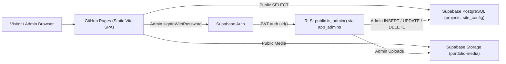

# GNOME Desktop Portfolio

An interactive developer portfolio modeled after the modern **GNOME Desktop Environment** and **Libadwaita** design language, built with React, TypeScript, Tailwind CSS v4, Framer Motion, and Supabase, and deployed to GitHub Pages.

- **Live Demo:** https://dnobstr.github.io/portfolio/
- **Current Milestone:** Milestone 1 — Foundation (active development)

---

## Current State (As It Is Today)

The site currently serves the **Milestone 1 Foundation** screen (`src/App.tsx`): a centered Libadwaita-styled window rendered over the default SVG wallpaper that verifies the design system, Supabase connectivity, and deployment pipeline before the full desktop shell is layered on top.

### Implemented Today

- **Adwaita / GNOME 47+ Design System** ([`src/index.css`](src/index.css), [`src/lib/adwaita.ts`](src/lib/adwaita.ts))
  - Live **Dark** and **Light** theme switching via `data-theme`.
  - All 7 official GNOME accent palettes (`blue`, `teal`, `green`, `orange`, `red`, `purple`, `slate`) via `data-accent`, tuned for accessible contrast.
  - Bundled `@fontsource/inter` and `@fontsource/jetbrains-mono` typography, Libadwaita surface tokens (`.adw-window`, `.adw-surface`, `.adw-input`), and overlay-style scrollbars.
- **Live Supabase Read Verification** ([`src/App.tsx`](src/App.tsx), [`src/lib/supabase.ts`](src/lib/supabase.ts))
  - Checks live read connectivity against `site_config` (row `#1`) and `projects` count on load.
  - Gracefully falls back to local default assets (`public/defaults/`) when `.env.local` is not configured.
- **PostgreSQL Schema, Storage & UUID-Based RLS** ([`supabase/migrations/001_initial_schema.sql`](supabase/migrations/001_initial_schema.sql))
  - Tables: `public.projects`, singleton `public.site_config` (`id = 1`), and `public.app_admins`.
  - Security model: public read-only access for visitors; write access (`INSERT`/`UPDATE`/`DELETE`) locked strictly to `auth.uid()` membership in `public.app_admins` via `public.is_admin()` — never tied to email strings, so changing the admin login email never breaks permissions.
  - Storage: `portfolio-media` bucket (25 MB limit, public-read / admin-write) supporting images, GIFs, MP4/WebM videos, PDFs, and Markdown files.
- **Core Types, Defaults & Tested Utilities** ([`src/types/`](src/types/), [`src/lib/defaults.ts`](src/lib/defaults.ts), [`src/lib/format.ts`](src/lib/format.ts))
  - Type definitions for database records, session states, window bounds/instances, and the desktop app registry (`APP_REGISTRY`).
  - Unit-tested helpers (Vitest) for external URL sanitization, upload MIME/size validation, screensaver type inference, and GNOME top-bar / lockscreen clock formatting.
- **Automated GitHub Pages CI/CD** ([`.github/workflows/deploy.yml`](.github/workflows/deploy.yml))
  - Builds on push to `main` with Vite vendor chunking, creates an SPA `404.html` fallback, and publishes to GitHub Pages.

---

## Planned Vision (What It Will Be)

The core data models, design tokens, and backend schema are already built to power a full **in-browser GNOME Desktop Environment** with an integrated headless CMS.

### Desktop Shell & Window Manager

- **GNOME Top Bar** — **Activities** overview toggle, live **Clock & Calendar** popover, and system/power menu.
- **Floating Bottom Dock** — Pinned application launchers with active/running indicators.
- **Libadwaita Window Manager** — Pointer-captured dragging, 8-way edge/corner resizing, z-index focus stacking, minimize/maximize/close controls, spring animations (`framer-motion`), and a responsive mobile fallback.

### Session Lifecycle

Defined in [`src/types/session.ts`](src/types/session.ts):

| State | Experience |
| :--- | :--- |
| `booting` | Plymouth-style boot splash screen displaying the configurable `boot_logo_url`. |
| `desktop` | Main interactive multi-window workspace. |
| `locked` | GDM-style lockscreen with clock/date and **Guest** / **Admin** user switching (`signInWithPassword`). |
| `sleeping` | Fullscreen screensaver supporting static images, GIFs, or looping MP4/WebM videos (`screensaver_url`). |
| `shutdown` | Graceful power-off sequence with a one-click power-on prompt. |

### Built-In Desktop Applications

Defined in [`APP_REGISTRY`](src/lib/adwaita.ts):

| App | Purpose |
| :--- | :--- |
| **Projects** | Browse featured work, filter by category, and read full GitHub-Flavored Markdown case studies. |
| **User (About Me)** | Profile bio, avatar, tech stack badges, and social/contact links. |
| **Documents** | Resume / CV PDF viewer and download. |
| **Text Editor (`readme.txt`)** | Read-only welcome notes and desktop guide backed by `site_config.readme_content`. |
| **Settings** | Dark/light appearance, 7 GNOME accent colors, animation toggle, and session controls. |
| **Admin Panel** *(Admin-only)* | In-OS CMS unlocked via Admin login to manage projects, upload media to `portfolio-media`, customize wallpaper/boot logo/screensaver/profile/`readme.txt`, and update admin credentials safely under UUID-based RLS. |

### Architecture Overview

---

## Tech Stack

- **Frontend:** React 19, TypeScript 5.8, Vite 6
- **Styling & UI:** Tailwind CSS v4 (`@tailwindcss/typography`), Libadwaita CSS tokens, Lucide React, Inter & JetBrains Mono (`@fontsource`)
- **Motion & Content:** Framer Motion, `react-markdown`, `remark-gfm`
- **Backend & CMS:** Supabase (`@supabase/supabase-js` — PostgreSQL, Row Level Security, Auth, Storage)
- **Testing & Deployment:** Vitest, GitHub Actions → GitHub Pages

---